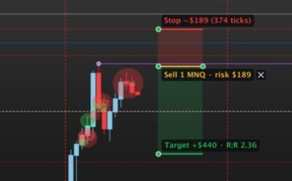

# Dollar Risk Box V2 for MotiveWave

**English** | [Русский](README.ru.md)

[](LICENSE)


A risk box for MotiveWave, made the way the author's research platform *Futures Tester* makes it: **one tool, three clicks** (entry, stop, target), the side follows the stop, and the number of contracts comes from your risk at an **honest 1R** — the stop plus slippage plus both commissions.



> **Display only.** The indicator is a plain MotiveWave *Study*. It has no access to the order API and **cannot place, modify or cancel orders**.

> **V1 stays.** [Dollar Risk Box V1](https://github.com/Stockmoney/motivewave-dollar-risk-box) (Long / Short buttons, more label options) is a separate indicator; both can be installed side by side.

## How to use

1. Press the yellow **Risk box** button (it says *draw only*), or press **R** with the mouse over the chart.
2. Click the **entry**, then the **stop**: a stop below the entry makes a **buy**, above it a **sell**. The stop zone follows the mouse.
3. Click the **target** on the other side of the entry. The target zone follows the mouse; the box is made on this click.

Esc cancels a box being placed. Drag the target, the stop or the entry line, or the whole box by its body; a stop or a target cannot be dragged across the entry. Remove a box with its **✕**, Delete/Backspace or Escape while the indicator is selected, or the right-click menu (*Delete this box*, *Flip (buy/sell)*, *Delete all boxes*).

## What the labels say

| Label | Example | Meaning |
|---|---|---|
| Target | `Target +$440 · R:R 2.36` | profit at the target **net of both commissions**; R:R = target ticks / stop ticks |
| Entry | `Sell 1 MNQ · risk $189` | side, contracts, product, the risk of all contracts |
| Stop | `Stop −$189 (374 ticks)` | the loss at the stop, and the stop in ticks |
| Warning | `1 contract costs more than the risk $100` / `limit: 40 contracts` | the risk is too small for even one contract (1 is shown anyway), or *Max contracts* capped the number |

With *Prices in the labels* on, each label also shows its price.

## How it is calculated

```
1R per contract = (stop in ticks + slippage ticks) × tick value + 2 × commission per side
contracts       = floor(budget / 1R), at least 1 and at most Max contracts
risk            = 1R × contracts
target          = (target in ticks × tick value − 2 × commission) × contracts
R:R             = target ticks / stop ticks
```

Example, MNQ (tick 0.25 = $0.50), $200 risk, stop 40 ticks, target 80 ticks, 1 tick slippage, $0.50 per side: 1R = 41 × $0.50 + $1.00 = $21.50 → 9 contracts, risk $193.50 (shown $194), target (80 × $0.50 − $1) × 9 = $351, R:R 2.00. This is exactly Futures Tester's `riskBoxSize`; the two were compared on 2,000 random boxes (MNQ and MGC, $ and % risk, different costs) with no difference.

## Commissions

- **Commission → Auto** (the default): if MotiveWave is connected to **Lucid Trading** (the platform's own log says which server it connected to), Lucid's published commission per side for the product is used — MNQ, MES, MYM, M2K, MCL $0.50; MGC $0.80; SIL $1.60; NQ, ES, YM, RTY, NKD $1.75; CL, QM, NG $2.00; QG $1.30; GC, SI, HG, PL $2.30; currencies $2.40; grains and meats $2.80 (Lucid's table of 26 Aug 2026). Otherwise, or for a product not in the table, the typed value is used.
- **Lucid Trading table**: always that table. **The value below**: always the typed value.
- **Commission per side ($)**: 0.50 by default.

Check the numbers with your broker: Lucid's page does not say whether exchange and NFA fees are included.

## Settings

| Tab | Setting | Default |
|---|---|---|
| General → Risk | Risk Type: Fixed Amount ($) / Percent of Balance; Risk ($); Risk (%); Account Balance ($) | $200; 0.4 %; $50,000 |
| | Max contracts | 40 |
| General → Costs | Commission: Auto / Lucid Trading table / The value below; Commission per side ($); Stop slippage (ticks) | Auto; 0.50; 1 |
| General → Panel | Show the Risk box button; R over the chart starts a box; New Box Width (bars); Escape cancels a box being placed; Delete key / Escape removes the selected box; Keep above my drawings | all on; 8 bars |
| Format | Target / Stop / Entry colours and fills; Font; Show Labels; Prices in the labels | green / red / yellow, fills 20 %; prices off |

*Account Balance* is typed in by hand: a MotiveWave indicator cannot read your broker account.

## Install

1. Download `DollarRiskBoxV2.jar` from the [latest release](../../releases/latest) (or build it, see below).
2. Put it into the **`MotiveWave Extensions`** folder in your home folder (on macOS `~/MotiveWave Extensions`). MotiveWave picks it up within seconds.
3. Add it from **Study → Alex Indicators → Dollar Risk Box V2**.

> Tested on macOS with MotiveWave 7.1.3 and CME futures (MNQ, MGC). *Keep above my drawings* reads the platform's internal chart layers (versions 7.1.1–7.1.3); on another version it switches itself off and the rest keeps working.

## Good to know

- **R** works only over the chart under the mouse, also with a Russian keyboard layout; it does nothing while you type in a field. Switch it off in the settings if you use R for something else.
- Boxes are stored with the chart and survive a restart or an update of the jar.
- After an update of the jar, the copy that was replaced stops its background check by itself.

## Build from source

Requirements: a JDK (17 or newer), `mwave_sdk.jar` and the JavaFX jars from your own MotiveWave installation — none of them is included here. On macOS `build.sh` finds them inside `/Applications/MotiveWave.app` by itself.

```bash
bash build.sh            # builds build/DollarRiskBoxV2.jar and runs the tests
bash build.sh install    # also copies it into ~/MotiveWave Extensions
```

The arithmetic (`dollar_risk_box_v2/core`: RiskSize, Labels, Costs) has no MotiveWave dependency and is covered by `test/dollar_risk_box_v2/Tests.java`. You can check the "no orders" claim yourself: `javap -v` on the compiled classes shows no reference to `order_mgmt` or `OrderContext`.

## Changelog

- **2.0.2** — no text under the Risk box button any more: only the button stays on the chart.
- **2.0.1** — buttons react to the first click: after a drag the platform sometimes sends no mouse-up click, and the next real press was taken for it and ignored; now only a click within 0.4 s of the end of a drag is ignored.
- **2.0.0** — first version: the risk box of Futures Tester (one tool and R, three clicks, side from the stop, honest 1R with slippage and commissions, at least 1 contract and a limit, net target, R:R by ticks), commissions Auto / Lucid / typed, zones visible while placing.

## License

MIT — see [LICENSE](LICENSE).
