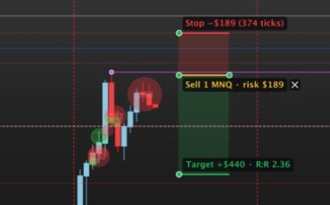

# Dollar Risk Box V2 для MotiveWave

[English](README.md) | **Русский**

[](LICENSE)


Бокс риска для MotiveWave, сделанный так, как его делает исследовательская платформа автора *Futures Tester*: **один инструмент, три клика** (вход, стоп, цель), сторона определяется по стопу, а число контрактов считается из вашего риска по **честному 1R** — стоп плюс проскальзывание плюс обе комиссии.



> **Только отображение.** Индикатор — обычный *Study* MotiveWave. Доступа к ордерам у него нет, он **не может выставить, изменить или снять ордер**.

> **V1 остаётся.** [Dollar Risk Box V1](https://github.com/Stockmoney/motivewave-dollar-risk-box) (кнопки Long / Short, больше настроек подписей) — отдельный индикатор; оба можно поставить рядом.

## Как пользоваться

1. Нажмите жёлтую кнопку **Risk box** (на ней написано *draw only*) или клавишу **R**, держа мышь над графиком.
2. Кликните **вход**, затем **стоп**: стоп ниже входа — **покупка**, выше — **продажа**. Зона стопа тянется за мышью.
3. Кликните **цель** по другую сторону входа. Зона цели тянется за мышью; на этом клике бокс готов.

Esc отменяет установку. Тяните линию цели, стопа или входа, или весь бокс за тело; стоп и цель нельзя перетащить через вход. Удалить бокс: его **✕**, Delete/Backspace или Escape при выбранном индикаторе, или меню правой кнопки (*Delete this box*, *Flip (buy/sell)*, *Delete all boxes*).

## Что пишут подписи

| Подпись | Пример | Значение |
|---|---|---|
| Цель | `Target +$440 · R:R 2.36` | прибыль на цели **после обеих комиссий**; R:R = тики цели / тики стопа |
| Вход | `Sell 1 MNQ · risk $189` | сторона, контракты, инструмент, риск всех контрактов |
| Стоп | `Stop −$189 (374 ticks)` | убыток на стопе и стоп в тиках |
| Предупреждение | `1 contract costs more than the risk $100` / `limit: 40 contracts` | риска не хватает даже на один контракт (всё равно показан 1) или число урезано настройкой *Max contracts* |

С галочкой *Prices in the labels* в каждой подписи есть и её цена.

## Как считается

```
1R на контракт = (стоп в тиках + тики проскальзывания) × цена тика + 2 × комиссия за сторону
контракты      = целая часть (бюджет / 1R), не меньше 1 и не больше Max contracts
риск           = 1R × контракты
цель           = (цель в тиках × цена тика − 2 × комиссия) × контракты
R:R            = тики цели / тики стопа
```

Пример, MNQ (тик 0,25 = $0,50), риск $200, стоп 40 тиков, цель 80 тиков, проскальзывание 1 тик, $0,50 за сторону: 1R = 41 × $0,50 + $1,00 = $21,50 → 9 контрактов, риск $193,50 (показано $194), цель (80 × $0,50 − $1) × 9 = $351, R:R 2,00. Это ровно `riskBoxSize` Futures Tester; оба сравнивались на 2 000 случайных боксов (MNQ и MGC, $ и % риска, разные издержки) — расхождений нет.

## Комиссии

- **Commission → Auto** (по умолчанию): если MotiveWave подключён к **Lucid Trading** (журнал самой платформы пишет, к какому серверу она подключилась), берётся опубликованная комиссия Lucid за сторону для инструмента — MNQ, MES, MYM, M2K, MCL $0,50; MGC $0,80; SIL $1,60; NQ, ES, YM, RTY, NKD $1,75; CL, QM, NG $2,00; QG $1,30; GC, SI, HG, PL $2,30; валюты $2,40; зерновые и мясо $2,80 (таблица Lucid от 26.08.2026). Иначе, или для инструмента не из таблицы, — значение из поля.
- **Lucid Trading table** — всегда эта таблица. **The value below** — всегда значение из поля.
- **Commission per side ($)** — по умолчанию 0,50.

Сверьте цифры со своим брокером: на странице Lucid не сказано, входят ли биржевые сборы и сборы NFA.

## Настройки

| Вкладка | Настройка | По умолчанию |
|---|---|---|
| General → Risk | Risk Type: Fixed Amount ($) / Percent of Balance; Risk ($); Risk (%); Account Balance ($) | $200; 0,4 %; $50 000 |
| | Max contracts | 40 |
| General → Costs | Commission: Auto / Lucid Trading table / The value below; Commission per side ($); Stop slippage (ticks) | Auto; 0,50; 1 |
| General → Panel | кнопка Risk box; R над графиком начинает бокс; ширина нового бокса (в барах); Escape отменяет установку; Delete / Escape удаляют выбранный бокс; Keep above my drawings | всё вкл; 8 баров |
| Format | цвета и заливки цели / стопа / входа; шрифт; подписи; цены в подписях | зелёный / красный / жёлтый, заливки 20 %; цены выкл |

*Account Balance* вводится вручную: индикатор MotiveWave не может прочитать счёт у брокера.

## Установка

1. Скачайте `DollarRiskBoxV2.jar` из [последнего релиза](../../releases/latest) (или соберите сами, см. ниже).
2. Положите его в папку **`MotiveWave Extensions`** в домашней папке (на macOS `~/MotiveWave Extensions`). MotiveWave подхватит его за несколько секунд.
3. Добавьте на график: **Study → Alex Indicators → Dollar Risk Box V2**.

> Проверено на macOS с MotiveWave 7.1.3 и фьючерсами CME (MNQ, MGC). *Keep above my drawings* читает внутренние слои графика платформы (версии 7.1.1–7.1.3); на другой версии эта функция выключается сама, остальное работает.

## Полезно знать

- **R** работает только над графиком под мышью, в том числе в русской раскладке; при вводе текста в поле ничего не делает. Если R нужна вам для другого — выключите её в настройках.
- Боксы хранятся вместе с графиком и переживают перезапуск и обновление jar.
- После обновления jar старая копия сама останавливает свою фоновую проверку.

## Сборка из исходников

Нужны JDK (17 или новее), `mwave_sdk.jar` и jar-файлы JavaFX из вашей установки MotiveWave — в репозитории их нет. На macOS `build.sh` сам находит их внутри `/Applications/MotiveWave.app`.

```bash
bash build.sh            # собирает build/DollarRiskBoxV2.jar и запускает тесты
bash build.sh install    # и копирует его в ~/MotiveWave Extensions
```

Расчёты (`dollar_risk_box_v2/core`: RiskSize, Labels, Costs) от MotiveWave не зависят и покрыты `test/dollar_risk_box_v2/Tests.java`. Проверить, что ордеров нет, можно самому: `javap -v` по собранным классам не находит ни `order_mgmt`, ни `OrderContext`.

## Изменения

- **2.0.2** — под кнопкой Risk box больше нет надписей: на графике остаётся только кнопка.
- **2.0.1** — кнопки срабатывают с первого клика: после перетаскивания платформа иногда не присылает клик отпускания мыши, и следующее настоящее нажатие терялось; теперь игнорируется только клик в первые 0,4 с после перетаскивания.
- **2.0.0** — первая версия: бокс риска Futures Tester (один инструмент и клавиша R, три клика, сторона по стопу, честный 1R с проскальзыванием и комиссиями, не меньше 1 контракта и предел, цель после комиссий, R:R по тикам), комиссии Auto / Lucid / вручную, зоны видны во время установки.

## Лицензия

MIT — см. [LICENSE](LICENSE).
